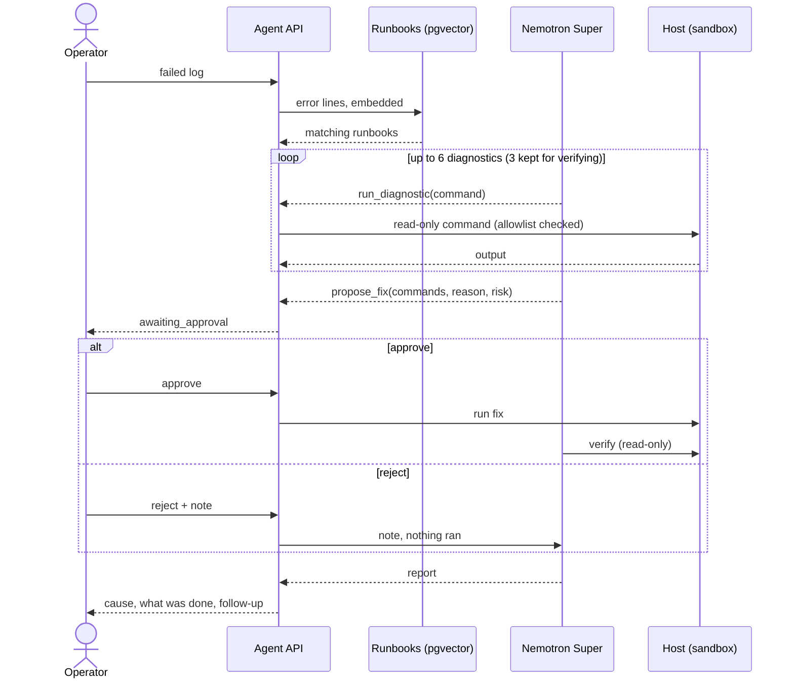

# AI Workbench

[](https://github.com/J-sterling/ai-workbench/actions/workflows/ci.yml)

A Terraform apply or an Ansible deploy fails at 2 a.m. The fix is usually in a runbook someone wrote months ago, but the on-call engineer still has to find it, check the host and type the fix by hand. Chat assistants guess without seeing the host; autonomous agents can see it, but nobody wants one running `docker volume rm` unasked.

AI Workbench sits in between. It reads the failed log, finds the matching runbook, checks the host with read-only commands, and proposes a fix with its reason and risk. **Nothing changes until a person approves.** It runs on NVIDIA Nemotron through Nebius Token Factory, with a live advisory check through Tavily when a runbook cites a CVE.

> Built for the Nebius x NVIDIA Global AI Hackathon 2026 (track: Best Apps and Agents).

**Live demo:** https://port8000-kgxq36m5ct93fax.tunnel.applications.uk-south1.nebius.cloud (Nebius Serverless AI endpoint, password-protected; the password is in the Devpost testing instructions). Commands run against a simulated host.

## How Nemotron, Token Factory and Tavily are used

| Part | Model or service | What it does |
|---|---|---|
| Agent loop | **NVIDIA Nemotron 3 Super** (`nvidia/nemotron-3-super-120b-a12b`) on **Nebius Token Factory** | Reads the log and runbooks, calls `run_diagnostic`, `search_runbooks`, `search_web` and `propose_fix` through native OpenAI `tools` / `tool_calls`, and writes the report. Live runs took 5–9 turns and 15–36k prompt tokens. |
| Runbook retrieval | **Qwen3-Embedding-8B** on **Nebius Token Factory**, 1024 dimensions | Embeds the runbooks (once, on the first run) and the log's error lines; the closest runbooks go into the prompt. The retrieval eval finds the right runbook for 15 of 15 test logs. |
| Live advisory check | **Tavily** search API | When a runbook cites a CVE, the server sends the agent's first fix back and asks for a live advisory check; advisory searches are limited to official domains (project, NVD, CISA, CERT-EU, distribution trackers). The approval card lists only sources the search returned. |
| Hosting | **Nebius Serverless AI** endpoint (CPU `cpu-d3`, 2 vCPU / 8 GB, `uk-south1`) | Runs the single container behind a managed HTTPS URL. |
| Secrets | **Nebius SecretStash** | Holds the Token Factory key, the Tavily key and the demo password; the endpoint reads them at start-up. None are in the image or the repo. |
| Cost tracking | **Nebius billing export** (FOCUS 1.2) | `scripts/finops-export.sh` turns it into the project's cost dashboard. |

**Why Super.** Token Factory exposes Super and Ultra through the same OpenAI-compatible API, so the model is one setting (`MODEL_SMART`). On these samples Super answered as well as Ultra, at similar speed and about a quarter of the cost per call, so the public demo offers Super only (`ALLOWED_MODELS`). Locally you can pick Ultra. Nemotron 3.5 Lightning isn't used: on the triage prompt it put its reasoning into the answer text.

**What Token Factory made easy.** The standard `openai` Python client works by changing the base URL. Tool calls work natively, so there is no output-parsing layer. Chat and embeddings share one key and one bill. Every call's token counts are logged (never the prompt text) and shown live on the Token usage page.

## Quick start

```bash
cp .env.example .env             # then set NEBIUS_API_KEY
docker compose up -d db          # Postgres + pgvector
uv run scripts/smoke_test.py     # check the key and models
uv run scripts/eval_retrieval.py # check each test log finds the right runbook (no DB needed)
uv run scripts/ingest_runbooks.py  # load runbooks/ into pgvector
uv run scripts/agent_demo.py 01-garage-down  # agent in the terminal; you approve the fix
uv run ai-workbench              # web UI and API on http://127.0.0.1:8000
uv run pytest                    # sandbox and approval-guard tests
scripts/install-hooks.sh         # before each commit: gitleaks secret scan + tests
```

## Runbook knowledge base

`runbooks/*.md` holds one failure per file: symptoms (with the exact error text), root cause, how to diagnose, the fix, and which steps need human approval. They are embedded with `Qwen/Qwen3-Embedding-8B` (1024 dims) into Postgres + pgvector. `POST /triage` pulls the error lines out of a log, retrieves the closest runbooks, and asks Nemotron for a diagnosis grounded in them.

Adding a runbook: write the markdown file, include the literal error strings, add a test case to `scripts/eval_retrieval.py`, and re-run ingest.

## User journey

An on-call engineer's Terraform run fails with `connection refused`. They hand the log to the agent, which finds the matching runbook, checks the host with read-only commands, and proposes a fix. **Nothing changes until the engineer approves.** After approval the agent runs the fix, verifies it and writes the report. The full journey map is in [docs/user-journey.html](docs/user-journey.html).



## Web UI

Open http://127.0.0.1:8000. Pick a sample (or paste a log), choose whether to use runbooks, and press **Run triage**. Steps appear live: runbooks retrieved, each check with its output, and refused checks with the reason. When the agent proposes a fix, an approval card shows the commands, why, the risk and a DESTRUCTIVE badge when it applies. Approve to run it in the sandbox, or reject with a note. The report follows, with turns, tokens and time spent on Token Factory.

Turn **Use runbooks** off to see the before/after: on sample 03 the model alone suggests exporting keys in the shell, while with the runbook it moves them to Ansible Vault and adds a fail-fast check.

**Public demo guards** (`.env`): `DEMO_PASSWORD` puts everything except `/health` behind a password, `DAILY_RUN_LIMIT` caps model-calling requests per UTC day, `MAX_LOG_BYTES` caps pasted logs, and only the Nemotron models in `ALLOWED_MODELS` can be chosen.

## The agent

`POST /agent/runs` (or `scripts/agent_demo.py`) runs Nemotron Super with native OpenAI tool calls in a loop:

1. **Retrieve**: the log's error lines pull the closest runbooks from pgvector.
2. **Diagnose**: the model calls `run_diagnostic` with read-only commands (`docker ps`, `docker logs`, `ls`, `curl`, `php -v`, `apt list` ...). The server checks every command, whatever the model says, and refuses it with a reason the model can act on. The checks are: an allowlist of read-only tools; per-tool rules for options that write or execute, such as `find -delete`, `curl -o` and `git remote add`; a check on every part of a chained command; and rules against reading common secret sources, such as `.env`, keys, `/proc/*/environ`, cloud metadata and `$TOKEN`-style variables (the model is told to check `${#VAR}` instead). It can also call `search_runbooks` again.

   The allowlist is a guardrail for an AI agent in a demo, not a security boundary: a determined attacker can find gaps in any pattern list. A real executor should also run diagnostics as an unprivileged, read-only user. `tests/test_sandbox.py` lists the commands it must refuse.
   **Web search (optional, Tavily).** With `TAVILY_API_KEY` set, the agent also has `search_web`. When a runbook it relies on cites a CVE, a fixed version or an advisory, the server sends its first fix back and asks it to check the live source. The agent is told to make that search with `official_only`, which limits results to official security sources (the project, NVD, CISA, CERT-EU, NCSC, distribution trackers, GitHub advisories). The gate asks once; it nudges, it doesn't guarantee a search. The report then says either "Runbook check: confirmed by <url>" or "may be out of date: ...". It can also search for an error string no runbook covers. Source URLs appear on the approval card and in the report; the server keeps only links the search actually returned, so a runbook's own link can't pose as a live check. Only the model's short query is sent, never the log; IPs, emails, credentials in URLs and token-like strings are removed first. There are at most 2 searches per run and `WEB_SEARCH_DAILY_LIMIT` (default 25) per day. The daily count is kept in `var/websearch.json`, and if that file can't be read, searching stops for the day.
3. **Propose**: anything that changes the system must go through `propose_fix`, with the commands, a reason and the risk. The run stops with status `awaiting_approval`. Fixes that delete volumes or data are flagged `destructive`.
4. **Approve or reject**: `POST /agent/runs/{id}/decision` with `{"approve": true}` or `{"approve": false, "note": "..."}`. Approved commands run; a rejection goes back to the model with the note.
5. **Verify and report**: after the fix, the model re-checks with diagnostics and writes the report: error group, root cause (citing the runbook), what was done and the follow-up.

Commands run against a **simulated host**: `samples/<name>.sandbox.json` maps command patterns to output and tracks state, so a diagnostic after an approved fix sees the fixed system. That keeps demos safe and repeatable. A real executor (SSH, Ansible ad-hoc) can replace `Sandbox` behind the same `run` / `apply` interface.

| Sample | What broke | Risky step held for approval |
|---|---|---|
| `01-garage-down` | Terraform state backend down: config bind-mount became a directory after a reboot | restore config, `docker start garage` |
| `02-ci-checkout-dns` | CI job can't resolve `gitea`: job containers on an isolated network | network change, `docker restart act_runner` |
| `03-blank-s3-creds` | Terraform 403: blank S3 credentials from the environment | (none; fix is in the playbook) |
| `04-php2shell-precheck` | Ansible deploy blocked: PHP 8.3.30 is vulnerable to PHP2Shell (CVE-2026-109618/109619, fixed 21 Oct 2026); unattended upgrades skip the PHP PPA | `apt-get install --only-upgrade 'php8.3-*'`, which restarts PHP-FPM |

## Token usage

Open http://127.0.0.1:8000/usage (or **Token usage →** in the header). It updates every 2 seconds. It shows calls, input and output tokens and time on Token Factory for today (UTC), tokens per minute over the last hour, a per-model breakdown, and the latest calls with their run ID. The web app and the scripts write to the same `var/usage.jsonl`, so the page shows both. For a cost estimate, set `PRICES` in `.env` from your Token Factory console, in USD per 1M tokens: `PRICES='{"nvidia/nemotron-3-super-120b-a12b": [input, output], "Qwen/Qwen3-Embedding-8B": [input]}'`.

## Intended use, limitations and data

**Intended use.** A triage assistant for engineers investigating failed infrastructure runs. It suggests causes and fixes; a person decides. Every change goes through an approval step, and nothing runs until someone approves it.

**Limitations.**
- In this demo, commands run against a **simulated host** (`samples/*.sandbox.json`), not real servers. Pasted logs with no sample behind them get no simulated output.
- The read-only check on diagnostics is a guardrail for an AI agent, not a security boundary (see [The agent](#the-agent)).
- Web search results can be wrong or stale. The approval card only lists links the search returned, but the report is the model's own text: check any source it cites. On the hosted demo the daily search counter lives on the container's disk and resets if the endpoint restarts.
- Answers can be wrong. The model can misread a log, and runbooks only cover the failures they describe. Treat the report as a starting point and check the proposed commands before approving.
- It is not designed for autonomous operation, or as a safety component of critical infrastructure. Keep a person in the loop.

**Data handling.**
- Logs you send, and the commands and outputs from a run, go to **Nebius Token Factory** for the model and embedding calls. Read Nebius's terms for how they process requests before using real logs.
- The app keeps runs only in memory (the last 200), never writes logs to disk or the database, and loses them on restart. The server log records only the run ID when a run fails.
- For the Usage page, each model call appends one line of counts to `var/usage.jsonl`: time, model, kind, tokens, seconds and the run ID. No prompt or log text.
- If web search is on, the agent's search queries (short public terms such as an error string or CVE ID, never the log) go to **Tavily**. Results can be wrong or out of date; the agent cites them so you can check.
- No third-party tracing or analytics is enabled.
- Infrastructure logs often contain personal data (usernames, emails, IP addresses) and secrets. Remove them before pasting into the public demo. For real use, add masking and a data processing agreement with your model provider, and check your obligations under UK GDPR / GDPR.

## Deploy (single container)

CI builds this image on every push to `main`. It checks it: health and the commit in `/health`, the password, Super only, no `.env`, non-root, and Trivy. It then publishes it as `ghcr.io/j-sterling/ai-workbench:latest` and `:sha-<commit>`.

### Nebius Serverless endpoint (live demo)

The demo endpoint runs a moving tag, `:demo`. Shipping a change keeps the same public URL:

```bash
scripts/promote.sh <commit>   # "Promote to demo" workflow retags sha-<commit> as :demo, restarts the endpoint,
                              # waits until /health reports <commit>, then smoke-tests (if DEMO_PASSWORD is set)
scripts/rollback.sh           # promotes the previous commit again (same URL)
scripts/endpoint.sh stop      # a stopped endpoint isn't billed; start/restart/status/url/logs too
scripts/deploy.sh             # first time only: creates the endpoint (CPU only, 20Gi disk, asks before creating)
```

**Costs.** `scripts/finops-export.sh` pulls the Nebius billing export (FOCUS 1.2 CSV, free and read-only; needs `NEBIUS_CONTRACT_ID` in `.env`) and builds daily cost rows in `var/finops/`, merged with `docs/tracker/finops_manual.json` (budget, run window, rates, and anything billed elsewhere, such as Token Factory). Bill data stays out of the repo.

Only commits that CI has published can be promoted, so every live version has passed the tests, the secret scan, the smoke test and Trivy. Nebius endpoints have no in-place update. If a restart ever fails to pull the new `:demo`, `promote.sh` stops with an error. The fallback is to delete and recreate the endpoint, which changes the URL.

The `Dockerfile` builds the web UI and agent into one image. Runbooks are searched in memory (`KB_BACKEND=memory`, embedded once on the first run, in about 3 seconds), so no database is needed. Only Nemotron Super can be chosen (`ALLOWED_MODELS`), and the server runs as one worker because runs and the daily cap live in memory.

```bash
docker build --platform linux/amd64 -t ai-workbench .
docker run --rm -p 8000:8000 -e NEBIUS_API_KEY=... -e DEMO_PASSWORD=... ai-workbench
```

Pass `NEBIUS_API_KEY` and `DEMO_PASSWORD` from the platform's secret store, never in the image (`.dockerignore` excludes `.env`). `/health` stays open for health checks; everything else needs the password when it is set.

## What's next

- **A real executor.** Replace the simulated host with SSH or Ansible ad-hoc commands, run as an unprivileged, read-only user behind the same `run` / `apply` interface.
- **Runbooks that learn.** Turn each approved fix, and each stale-runbook finding from the live advisory check, into a runbook update for review.
- **Masking before the model.** Strip personal data and secrets from logs before they reach Token Factory, for use with real logs.
- **More failure types.** Kubernetes and cloud-provider runbooks and samples, with a retrieval eval case for each.

## Licence

Apache 2.0 - see [LICENSE](LICENSE).
