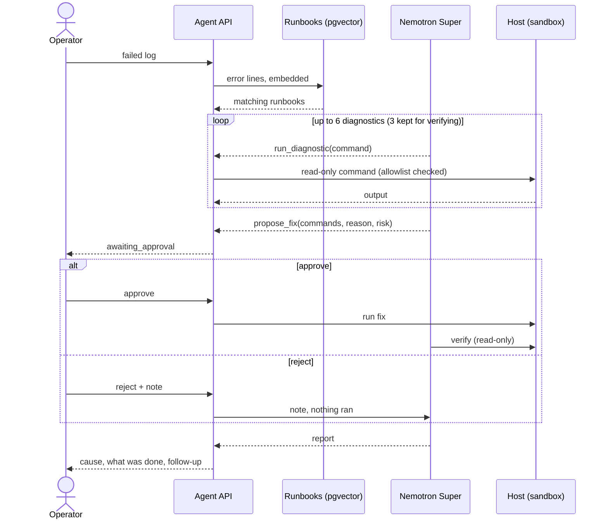

# AI Workbench

A self-hostable AI workbench built on Nebius Token Factory and NVIDIA Nemotron:
connect your data, run an agent over it, and approve any risky action before it happens.
The demo agent triages failed infrastructure runs (Ansible / Terraform logs).

> Work in progress for the Nebius x NVIDIA Global AI Hackathon 2026.

## Quick start

```bash
cp .env.example .env             # then set NEBIUS_API_KEY
docker compose up -d db          # Postgres + pgvector
uv run scripts/smoke_test.py     # check the key and models
uv run scripts/eval_retrieval.py # check each test log finds the right runbook (no DB needed)
uv run scripts/ingest_runbooks.py  # load runbooks/ into pgvector
uv run scripts/agent_demo.py 01-garage-down  # agent in the terminal; you approve the fix
uv run ai-workbench              # web UI and API on http://127.0.0.1:8000
uv run pytest                    # sandbox and approval-guard tests
```

## Runbook knowledge base

`runbooks/*.md` holds one failure per file: symptoms (with the exact error text), root cause, how to diagnose, the fix, and which steps need human approval. They are embedded with `Qwen/Qwen3-Embedding-8B` (1024 dims) into Postgres + pgvector. `POST /triage` pulls the error lines out of a log, retrieves the closest runbooks, and asks Nemotron for a diagnosis grounded in them.

Adding a runbook: write the markdown file, include the literal error strings, add a test case to `scripts/eval_retrieval.py`, and re-run ingest.

## User journey

An on-call engineer's Terraform run fails with `connection refused`. They hand the log to the agent, which finds the matching runbook, checks the host with read-only commands, and proposes a fix. **Nothing changes until the engineer approves.** After approval the agent runs the fix, verifies it and writes the report. The full journey map is in [docs/user-journey.html](docs/user-journey.html).



## Web UI

Open http://127.0.0.1:8000. Pick a sample (or paste a log), choose whether to use runbooks, and press **Run triage**. Steps appear live: runbooks retrieved, each check with its output, and refused checks with the reason. When the agent proposes a fix, an approval card shows the commands, why, the risk and a DESTRUCTIVE badge when it applies. Approve to run it in the sandbox, or reject with a note. The report follows, with turns, tokens and time spent on Token Factory.

Turn **Use runbooks** off to see the before/after: on sample 03 the model alone suggests exporting keys in the shell, while with the runbook it moves them to Ansible Vault and adds a fail-fast check.

**Public demo guards** (`.env`): `DEMO_PASSWORD` puts everything except `/health` behind a password, `DAILY_RUN_LIMIT` caps model-calling requests per UTC day, `MAX_LOG_BYTES` caps pasted logs, and only the Nemotron models in `ALLOWED_MODELS` can be chosen.

## The agent

`POST /agent/runs` (or `scripts/agent_demo.py`) runs Nemotron Super with native OpenAI tool calls in a loop:

1. **Retrieve**: the log's error lines pull the closest runbooks from pgvector.
2. **Diagnose**: the model calls `run_diagnostic` with read-only commands (`docker ps`, `docker logs`, `ls`, `curl` ...). The server checks every command, whatever the model says, and refuses it with a reason the model can act on. The checks are: an allowlist of read-only tools; per-tool rules for options that write or execute, such as `find -delete`, `curl -o` and `git remote add`; a check on every part of a chained command; and rules against reading common secret sources, such as `.env`, keys, `/proc/*/environ`, cloud metadata and `$TOKEN`-style variables (the model is told to check `${#VAR}` instead). It can also call `search_runbooks` again.

   The allowlist is a guardrail for an AI agent in a demo, not a security boundary: a determined attacker can find gaps in any pattern list. A real executor should also run diagnostics as an unprivileged, read-only user. `tests/test_sandbox.py` lists the commands it must refuse.
3. **Propose**: anything that changes the system must go through `propose_fix`, with the commands, a reason and the risk. The run stops with status `awaiting_approval`. Fixes that delete volumes or data are flagged `destructive`.
4. **Approve or reject**: `POST /agent/runs/{id}/decision` with `{"approve": true}` or `{"approve": false, "note": "..."}`. Approved commands run; a rejection goes back to the model with the note.
5. **Verify and report**: after the fix, the model re-checks with diagnostics and writes the report: error group, root cause (citing the runbook), what was done and the follow-up.

Commands run against a **simulated host**: `samples/<name>.sandbox.json` maps command patterns to output and tracks state, so a diagnostic after an approved fix sees the fixed system. That keeps demos safe and repeatable. A real executor (SSH, Ansible ad-hoc) can replace `Sandbox` behind the same `run` / `apply` interface.

| Sample | What broke | Risky step held for approval |
|---|---|---|
| `01-garage-down` | Terraform state backend down: config bind-mount became a directory after a reboot | restore config, `docker start garage` |
| `02-ci-checkout-dns` | CI job can't resolve `gitea`: job containers on an isolated network | network change, `docker restart act_runner` |
| `03-blank-s3-creds` | Terraform 403: blank S3 credentials from the environment | (none; fix is in the playbook) |

## Token usage

Open http://127.0.0.1:8000/usage (or **Token usage →** in the header). It updates every 2 seconds. It shows calls, input and output tokens and time on Token Factory for today (UTC), tokens per minute over the last hour, a per-model breakdown, and the latest calls with their run ID. The web app and the scripts write to the same `var/usage.jsonl`, so the page shows both. For a cost estimate, set `PRICES` in `.env` from your Token Factory console, in USD per 1M tokens: `PRICES='{"nvidia/nemotron-3-super-120b-a12b": [input, output], "Qwen/Qwen3-Embedding-8B": [input]}'`.

## Intended use, limitations and data

**Intended use.** A triage assistant for engineers investigating failed infrastructure runs. It suggests causes and fixes; a person decides. Every change goes through an approval step, and nothing runs until someone approves it.

**Limitations.**
- In this demo, commands run against a **simulated host** (`samples/*.sandbox.json`), not real servers. Pasted logs with no sample behind them get no simulated output.
- The read-only check on diagnostics is a guardrail for an AI agent, not a security boundary (see [The agent](#the-agent)).
- Answers can be wrong. The model can misread a log, and runbooks only cover the failures they describe. Treat the report as a starting point and check the proposed commands before approving.
- It is not designed for autonomous operation, or as a safety component of critical infrastructure. Keep a person in the loop.

**Data handling.**
- Logs you send, and the commands and outputs from a run, go to **Nebius Token Factory** for the model and embedding calls. Read Nebius's terms for how they process requests before using real logs.
- The app keeps runs only in memory (the last 200), never writes logs to disk or the database, and loses them on restart. The server log records only the run ID when a run fails.
- For the Usage page, each model call appends one line of counts to `var/usage.jsonl`: time, model, kind, tokens, seconds and the run ID. No prompt or log text.
- No third-party tracing or analytics is enabled.
- Infrastructure logs often contain personal data (usernames, emails, IP addresses) and secrets. Remove them before pasting into the public demo. For real use, add masking and a data processing agreement with your model provider, and check your obligations under UK GDPR / GDPR.

## Deploy (single container)

The `Dockerfile` builds the web UI and agent into one image. Runbooks are searched in memory (`KB_BACKEND=memory`, embedded once at startup in about 3 seconds), so no database is needed. Only Nemotron Super can be chosen (`ALLOWED_MODELS`), and the server runs as one worker because runs and the daily cap live in memory.

```bash
docker build --platform linux/amd64 -t ai-workbench .
docker run --rm -p 8000:8000 -e NEBIUS_API_KEY=... -e DEMO_PASSWORD=... ai-workbench
```

Pass `NEBIUS_API_KEY` and `DEMO_PASSWORD` from the platform's secret store, never in the image (`.dockerignore` excludes `.env`). `/health` stays open for health checks; everything else needs the password when it is set.

## Licence

Apache 2.0 - see [LICENSE](LICENSE).
